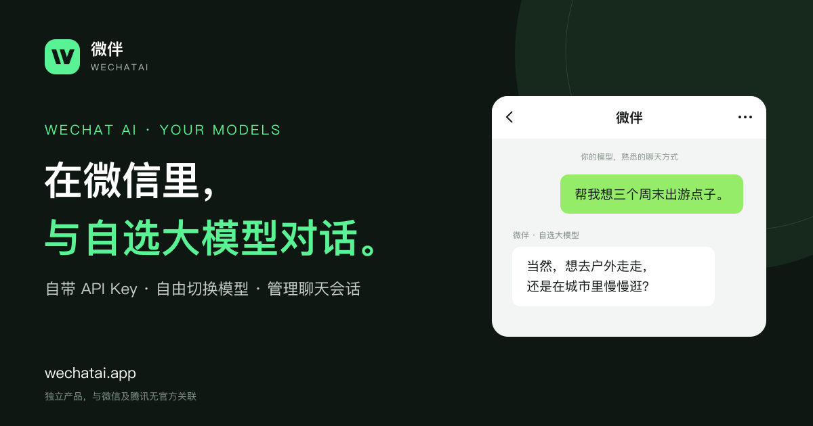
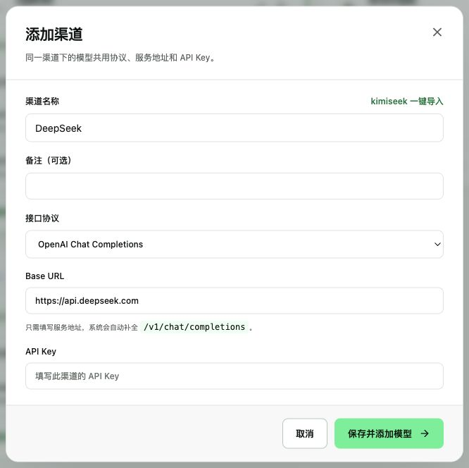
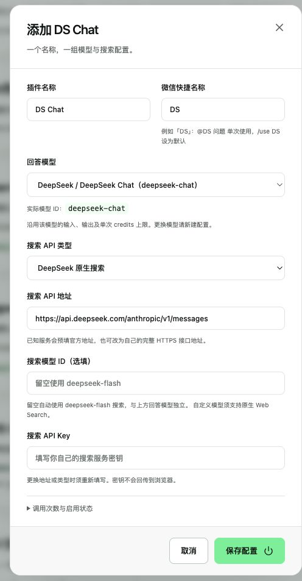
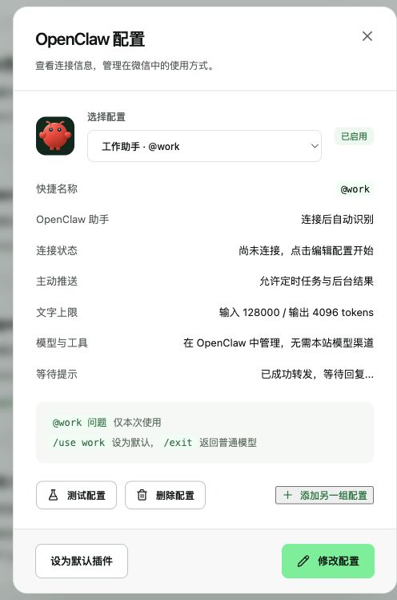

<div align="center">

# 微伴 Wechatai

**把你的 AI 接入微信。**

自带模型 API，把日常对话、联网问答、个人助理和自己的 Agent 放进微信。

[在线使用](https://wechatai.app) · [使用文档](https://wechatai.app/docs) · [插件协议](https://wechatai.app/developers/plugins) · [反馈问题](https://github.com/moutsea/wechatai/issues)



</div>

## 可以做什么

- **自由选择模型**：支持 OpenAI Chat Completions、OpenAI Responses、Anthropic Messages 三种协议。一个渠道可添加多个模型，也可从上游导入文本和生图模型。
- **在微信里切换**：`@快捷名 内容` 临时调用模型或插件，`/use 快捷名` 设为默认，`/exit` 返回普通模型。支持多条微信连接和独立会话。
- **长对话**：自动摘要、保留最近对话、上下文超限重试。每个模型可单独限制输入、输出和单轮 credits 消耗。
- **图片与文档**：连续发送图片、PDF、DOCX 或文本文件，再发文字或带转写的语音说明要求，附件会合并处理。
- **管理会话**：在网页查看 Markdown 聊天记录，切换、归档、重置、清理会话。
- **SaaS 基础功能**：邮箱密码与 Google / GitHub 登录、会员、credits、Stripe 支付、邀请奖励、管理后台和付款通知。

模型、搜索、生图接口由用户自行配置。微伴不附送上游 API，也不托管 OpenClaw / Hermes 的运行环境。项目独立开发，与腾讯、微信和模型供应商没有官方关联。

站内通知支持管理员保存草稿、发布普通或重要通知、Markdown 预览、编辑、下架和删除。用户从工作台右上角小铃铛或「通知」页面查看；重要通知在工作台顶部展示，已读和关闭状态按用户保存。后台入口为「管理后台 → 通知管理」，Free 和 Plus 用户均可接收。

## 内置插件

| 插件     | 用途                                                             |
| -------- | ---------------------------------------------------------------- |
| DS Chat  | 模型按需调用搜索和网页阅读工具；回答模型、搜索服务均可配置       |
| AI 生图  | 使用自己的生图 API，在微信里生成并接收图片                       |
| OpenClaw | 将自己运行的 OpenClaw 接入微信，支持多个配置、原生命令和主动推送 |
| Hermes   | 将自己运行的 Hermes 接入微信，支持后台任务与定时任务的结果回传   |
| 角色扮演 | 自定义人设、开场白、对话示例和世界书，导入角色卡                 |
| 个人助理 | 笔记、待办清单、记账、独立提醒与每日待办提醒                     |
| 消息提醒 | 专属 Token 接收 HTTP 请求并转发到微信，不调用模型                |

目前是内置插件与专用 Agent 连接器。插件市场、用户上传代码和云端托管 Agent 尚未实现。[插件开发说明](docs/plugins.md)解释了已有能力和协议预留部分。

<details>
<summary>查看配置界面</summary>

| 模型渠道                                             | DS Chat                                             | OpenClaw                                             |
| ---------------------------------------------------- | --------------------------------------------------- | ---------------------------------------------------- |
|  |  |  |

</details>

## 快速开始

需要 **Node.js 22.19+** 和 **pnpm 10**。核心应用本地运行不需要 Cloudflare 账号；实际聊天需要可用的模型 API 和微信 ClawBot 入口。

```sh
git clone https://github.com/moutsea/wechatai.git
cd wechatai
pnpm install --frozen-lockfile
pnpm setup:local
pnpm dev
```

打开 [localhost:5173](http://localhost:5173)：

1. 注册账号，在「渠道与模型」中填写协议、Base URL、API Key 并添加模型。
2. 在「微信连接」创建链接，使用手机微信 **设置 → 插件（部分版本位于“功能”）→ 微信 ClawBot → 扫一扫** 完成绑定。
3. 在绑定的微信对话中发消息。发送 `/wx help` 查看命令。

`setup:local` 会生成独立的本地密钥、运行时类型并执行 D1 迁移，不覆盖已有 `.dev.vars`。本地数据保存在 `.wrangler/state`。无账号也可打开 [/demo](http://localhost:5173/demo) 查看交互预览，预览不会调用真实服务。

OAuth、支付和 KimiSeek 一键导入都是可选集成，未配置时基础邮箱登录与自备 API 渠道仍可使用。项目保留 Free / Plus 套餐规则，Free 最多配置 1 个插件，Plus 插件配置数量不限，网页历史及附件输入等功能需要 Plus 权益；**开源许可证不等于线上服务免费会员**。自部署可按自己的产品需求调整套餐和额度规则，见[配置说明](docs/configuration.md)。

## 文档

| 文档                                    | 内容                                               |
| --------------------------------------- | -------------------------------------------------- |
| [本地开发](docs/development.md)         | 环境、常用命令、测试、连接器联调                   |
| [配置说明](docs/configuration.md)       | 密钥、OAuth、模型、套餐、可选集成                  |
| [部署到 Cloudflare](docs/deployment.md) | D1、R2、提醒、可选收消息服务与执行器、管理员、备份 |
| [支付与通知](docs/billing.md)           | Stripe 业务隔离、会员与 credits、管理员付款通知    |
| [架构说明](docs/architecture.md)        | 数据隔离、消息链路、上下文与调度                   |
| [插件开发](docs/plugins.md)             | 协议、计量、Agent 接入、开发边界                   |
| [贡献指南](CONTRIBUTING.md)             | 提交问题、开发检查、Pull Request                   |
| [安全报告](SECURITY.md)                 | 私下报告漏洞，避免公开凭据和用户数据               |

网页用户教程位于 [/docs](https://wechatai.app/docs)。Agent 可读取 [/llms.txt](https://wechatai.app/llms.txt)、[Markdown 协议](https://wechatai.app/developers/plugins.md)和 [JSON Schema](https://wechatai.app/api/plugins/protocol/1.0/schema.json)。

## 技术栈与目录

React / Vite / TypeScript · Hono · Cloudflare Workers / Durable Objects / D1 / R2 · Better Auth · Stripe

```text
src/client/       页面、组件与样式
src/server/       HTTP API、账户、微信、模型网关与调度
src/shared/       类型、校验、计费规则与公开文档数据
integrations/     OpenClaw、Hermes 连接器
migrations/       D1 数据库迁移
public/           静态资源、文档截图与连接器下载
scripts/          本地初始化、打包、验证与运维工具
test/             workerd / SQLite 集成测试
docs/             开发与部署文档
design/           插件协议、资源来源与后续方案
```

## 检查

```sh
pnpm check                 # lint、类型、测试、构建、公开页面 SEO 检查
pnpm test:openclaw          # 独立连接器传输测试
pnpm check:public          # 检查暂存区/已跟踪文件中的私密文件和凭据
```

GitHub Actions 在推送和 Pull Request 时执行基础检查。OpenClaw / Hermes 原生 SDK 测试需要另外安装对应运行环境，说明见[本地开发](docs/development.md)。

## 许可证与致谢

项目源代码采用 [MIT License](LICENSE)。第三方依赖及品牌素材保留各自权利与许可证，见 [THIRD_PARTY_NOTICES.md](THIRD_PARTY_NOTICES.md)。

感谢 [AgentFlowing](https://github.com/moutsea/agentflowing)、[OpeniLink](https://github.com/openilink/openilink-hub)、[DeepSeek Harness](https://github.com/deepseek-ai/deepseek-harness)、[OpenClaw](https://github.com/openclaw/openclaw) 和 [Hermes Agent](https://github.com/NousResearch/hermes-agent) 提供的实现参考与接口。源码开放不代表获得这些项目或服务商的官方背书。
