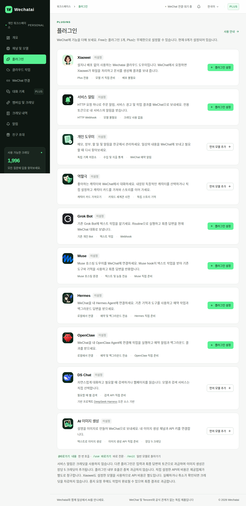
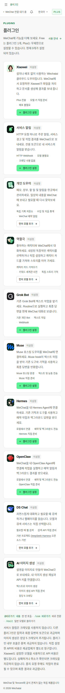

# wechatai 韩语工作台子路由本地化需求评估

评估日期为 2026-11-27。当前卡为 `f78c690a-39b8-44ab-b1f6-8392d286fd07`，标题为「wechatai 工作台韩语子路由本地化（/ko/app/*）」。仓库为 `moutsea/wechatai`。原需求中的 `koNAME` 按卡标题和语言代码解释为韩语。

## 当前执行决定（2026-11-28）

2026-11-27 23:55 的卡面决定已解除英语前驱依赖，当前依赖列表为空。本卡按原子卡规则独立开发与上线。本节替代下文历史记录中的等待英语 PASS、合入 main 和工作树接管条件。实现直接基于已核实的 main `3f329352ac0d73da0ee1611ce4169bbfd7fe1443`，只补齐本卡所需的路由、导航与韩语文案。共用文件通过原有中文和其他语言测试验证。

现有工作树可读写。Kandev 接管仍要求关联仓库，关联工具因 active turn 拒绝，本轮保留这一编排问题并继续本地实施。OPEN PR 查询返回空列表。功能、测试、文档在本卡独立分支交付，PR base main，保持 OPEN。

## 原子性、规模和责任

本卡可以作为一个原子任务，交付一个以 `main` 为 base 的 PR。唯一结果是让韩语工作台已有子页可直接访问，工作台导航保持韩语，产品界面使用韩语文案。路由登记、静态页面壳、侧栏链接、页面文案和回跳共同构成这一工作台本地化流程，可以整卡评审和回退。

规模预估为大，覆盖 12 个静态入口、一类动态详情路由及其现有弹窗和管理页签。实际代码量取决于日语、英语前驱合入后的共用实现。按页面调用链串行审查，最后对同一 base/head 验收整个 PR。文件数与行数不作为拆卡依据。

风险级别为中。主要风险是共用路由回归、直接刷新仍出现 404、文案遗漏、URL query/hash 丢失。`authReturnPath` 的允许范围涉及安全校验，按安全敏感改动单独核对。账单和后台仅做展示本地化，验收需要比较金额、额度、权限边界与请求负载。

PR 负责人为本卡开发承接人 Codex，工作流 profile 为 `92d67037-1df0-4f19-bf5e-8cb0c4965f2b`。负责人负责本卡独立分支、实现、测试证据和返工。独立评审阶段审核最终 HEAD，开 PR 阶段创建或复用本卡唯一 PR。PR 保持 OPEN，禁止合并和部署，该约束贯穿本卡后续阶段。

## 核实的现状

- 本轮 `git ls-remote` 核对 GitHub `main` 为 `3f329352ac0d73da0ee1611ce4169bbfd7fe1443`，本任务工作树 HEAD 与之相同。
- PR #47 已 MERGED，merge commit 为 `f78d953e94fa33dbe19071514d519f0b0eeb9c1d`。本轮 `gh pr list -R moutsea/wechatai --state open` 返回空列表。
- 已读 README、CONTRIBUTING、开发说明、package.json、相关路由、页面、词典、构建与测试。任务目录和业务仓库内未找到适用的 AGENTS.md。
- `src/client/main.tsx` 的 `appRouteTarget` 仅在去除语言前缀后的路径等于 `/app` 时进入本地化 Workspace。`src/shared/i18n/ko/dashboard.ts` 只登记了 `/app`。
- `src/client/workspace.tsx` 已提供全部现有页面组件，包含 `tasks/:id?` 和 `assistants` 渠道页别名。未知子路由回退到 `/app`。
- `src/client/context.tsx` 的 `base` 固定为 `/app`。Shell 侧栏、顶部连接入口、通知、账单和其他页面通过该值生成链接。admin 返回和 `src/client/plugin-upgrade.ts` 等还有硬编码 `/app` 路径。
- `src/shared/seo.ts` 的 `localizedDashboardPaths()` 只枚举各语言工作台根路径，`scripts/prerender.mjs` 据此生成静态私有壳及 noindex 响应头。`public/_redirects` 的任务详情 rewrite 目前只有 `/app/tasks/*`。生产资产配置使用 404 页面兜底，因此只修客户端路由不足以满足直接访问验收。
- `src/shared/auth.ts` 接受 `/ko/app`，对 `/ko/app/channels` 等子路径回退 `/app`。`test/auth.test.ts` 第 306–309 行对各语言子页的回退有明确断言。
- `src/client/pages/admin.tsx` 在已登录用户无权限时显示拒绝访问提示。未登录或会话失效时由 AppProvider 进入现有 `/login?returnTo=...`。
- 韩语 `copy/dashboard.ts` 已有 dashboard、onboarding、shell、membership、notices 五组。独立 Notices 页面和 Billing、Credits、Invite、Channels、Plugins、CloudTasks、Wechat、Sessions、Admin 及部分嵌套组件仍有固定中文文案。
- 韩语已有首页、定价和专题页登记，但当前没有韩语 `/docs` 和 `/docs/*` 教程登记。`localizedHref` 只为已登记译文加前缀，帮助链接当前保留可访问的原路径。

## 范围

1. 复用现有 Workspace、页面组件及 `localizedPath`、`splitLocalePath`、`localizedHref`，补齐以下入口。

   - `/ko/app`
   - `/ko/app/channels`
   - `/ko/app/assistants`
   - `/ko/app/plugins`
   - `/ko/app/tasks`
   - `/ko/app/tasks/:id`
   - `/ko/app/wechat`
   - `/ko/app/sessions`
   - `/ko/app/billing`
   - `/ko/app/credits`
   - `/ko/app/invite`
   - `/ko/app/notices`
   - `/ko/app/admin`

2. 修正工作台侧栏、当前项、面包屑、概览入口、通知铃铛、账单与额度互链、任务详情和返回、管理页返回、插件升级返回等现有跳转。目标为工作台页面的链接保持 `/ko/app...`，保留其已有 query/hash 语义。避免对已经带前缀的 base 再次拼接语言。
3. 页面标题、描述、按钮、字段、表头、无障碍名称、加载、空态、错误、校验、确认弹窗和管理页签使用韩语。复用前驱提供的取词方式，韩语缺失键补在 `src/shared/i18n/ko/copy/` 的合适文件中。类型约束以已合入前驱为准，避免为本卡改写其他语言的 copy。
4. 用户名称、模型名称、用户输入、聊天记录、管理员发布的通知正文按原始内容展示。产品自己提供的状态标签和错误提示属于翻译范围。通过现有错误码或本地失败提示覆盖已知中文产品提示，保持请求与错误处理机制。
5. 静态私有壳、任务详情 rewrite、语言元数据和 noindex 与客户端路由一致，私有工作台保持在公开索引之外。
6. 未登录和会话失效进入现有 `/login`，登录后返回原韩语子页。已登录无权限展示韩语拒绝访问提示并提供 `/ko/app` 返回入口。已有韩语公开目标使用语言前缀，尚无译文的教程使用现有可达入口。用户已于 2026-11-27 确认这两项验收口径。

## 不做范围

- 本卡语言范围为韩语工作台。中文默认行为、英语默认行为和日语、英语前驱交付结果作为回归边界。
- 计费计算、额度数字、套餐与货币、支付回调业务、身份认证协议、管理员权限规则、生产配置均在本卡范围外。schema 与迁移仅允许用户于 2026-11-28 授权的 AC2 最小订单返回路径字段。
- 新功能、路由新语义、通用 i18n 框架、队列、重试系统、依赖升级和部署改造均在范围外。
- 公开教程的整篇韩语翻译属于范围外。用户已确认本卡保留尚无韩语译文教程的现有可达入口。
- 自动翻译用户数据、通知正文和聊天记录在范围外。
- 禁止合并和部署。

## 验收标准

- AC1 路由与刷新。登录用户直接打开并刷新上述 12 个静态入口，HTTP 壳返回 200 且显示相应组件。测试夹具提供的一条 `/ko/app/tasks/:id` 详情可直接访问和刷新。`assistants` 沿用渠道页语义。未知子路径按既有工作台兜底语义处理并保留韩语。
- AC2 导航。桌面和 390px 窄屏逐项点击侧栏，URL 保持 `/ko/`，激活项与当前页标题一致。逐项覆盖概览、通知、billing/credits、invite、任务详情返回、admin 返回及插件升级返回。已有 query/hash 保留正确。
- AC3 韩语文案。各页的加载、空态、有数据、失败、表单校验、确认弹窗，以及现有管理页签均显示韩语固定文案。已知产品错误提示不能默认回退中文。以带中文用户内容的夹具验证原始内容完整保留。
- AC4 登录回跳。未登录和会话失效访问 `/ko/app/...?...#...` 时进入现有登录流程，登录后回到同一韩语目标。回跳校验继续拒绝外部地址、协议相对地址、反斜线地址和规范化后越出允许范围的路径。已登录但无管理权限时显示韩语拒绝访问提示，返回入口指向 `/ko/app`。
- AC5 数值与权限回归。相同 fixture 下比较韩语与中文 billing、credits 和管理数据，金额、币种、额度、单位、奖励规则和计费时区表达正确。现有 API 路径、请求负载和权限判断通过回归测试，普通用户仍受管理接口权限限制。
- AC6 公开链接。工作台内指向已登记韩语公开页面的链接使用现有本地化工具并可达。尚无韩语译文的教程沿用现有可达入口，验证原目标及 query/hash；已登记的韩语目标验证 `/ko/` 前缀。
- AC7 构建与索引。以真实构建产物验证韩语入口和动态详情直接访问，HTML lang 为 `ko-KR`，韩语标题和私有页 noindex 正确。sitemap、llms 和公开文档索引符合既有公开页面白名单。
- AC8 既有路由回归。`/app` 和全部现有 `/app/*`、日语与英语前驱交付的工作台路径及原有公开页面正常。语言切换遵守实际登记的翻译目标。
- AC9 文档隔离。本文件位于业务仓库根 `internal-docs/`。最终静态资产、客户端与服务端文档 bundle、公开文档索引及 `/api/docs` 响应若存在，均不含本文件标题、卡号和正文。测试报告说明使用的产物与检索范围。
- AC10 PR 交付。一个 PR，base 为 main，保持 OPEN。提供最终 base/head SHA、实际测试结果、桌面与窄屏截图、文件冲突核对和整卡独立评审结论。

## 实施与验证顺序

1. 英语前驱完成且相关提交在 main 可用后，更新本卡基线并复核剩余缺口。优先复用前驱已经完成的共用路由、链接和取词能力。
2. 补韩语子页登记和构建入口，沿现有 base 生成链修正工作台链接。
3. 按普通工作台页面、插件与任务详情、管理页签顺序串行补韩语 copy。仅为实际调用新增必要键，相关文案和内链随对应页面一起验收。
4. 复用前驱已交付的回跳支持，补齐韩语工作台子路径的允许范围及安全回归用例，沿用现有登录和拒绝访问机制。
5. 扩展现有测试以覆盖每个路由的直接访问、刷新、链接、加载与失败文案、无权限和 query/hash。现有 `test/browser/dashboard-i18n.spec.ts` 只验证首页，不能替代子页检查。
6. 运行仓库已有检查并记录真实输出。CONTRIBUTING 要求 `pnpm check`、`pnpm test:openclaw`，暂存本卡目标文件后运行 `pnpm check:public`。`pnpm check` 包含 lint、typecheck、服务端与客户端测试、构建和 SEO。开发说明还要求构建后运行 `pnpm test:browser`。参数先核对脚本或帮助。

相关测试入口已确认包括 `test/auth.test.ts`、`test/auth-expiry.client.test.tsx`、`test/dashboard.client.test.tsx`、`test/i18n-ko.client.test.tsx`、`test/site-notices.test.ts`、`test/admin.test.ts`、`test/admin-analytics.client.test.tsx` 和 `test/browser/dashboard-i18n.spec.ts`。沿用隔离 fixture 和假 API。确有本次具体回归缺口时补测试，功能与测试在同一 PR 交付。

全量测试、构建和浏览器重活串行。每次开始前读取 load、MemAvailable 和已有重活进程；已有重活或 MemAvailable 小于 2 GiB 时等待并说明。遵守全局会话上限 4，本卡由单一 agent 执行。需求评估阶段执行源码与 GitHub 只读检查，尚未运行功能测试或构建。

## 依赖、分支与文件冲突

用户要求 ja → en → ko → es → pt。当前卡唯一线性前驱为英语卡 `b834d2fa-8196-4154-8a1e-18d6e56722bb`，标题为「wechatai 工作台英语子路由本地化（/en/app/*）」。英语卡已有日语前驱 `9268595d-45ed-42ff-9795-03a094dae572`。本轮已用 `add_task_dependency_kandev` 将英语卡登记为本卡唯一 depends_on，返回 blocked=true、blocked_reason=pending。

2026-11-27 开发阶段复核时，英语卡已确认需求，卡状态为 SCHEDULING，主会话为 WAITING_FOR_INPUT，其日语前驱和仓库接管仍待处理。尚未取得英语卡正式 PASS 与实现提交，韩语实际开发以英语卡正式通过并合入后的 main 为基线。

当前独立分支为 `feature/f78c690a-ko-app-subroutes`。评估文档与本卡后续实现共用此分支。实现时记录同步前驱后的 base SHA，提交信息含卡号 `f78c690a`。回滚为整体回退本卡 PR，恢复到含英语前驱的基线，无数据迁移步骤。

以下共用文件以英语卡先合并为基线，其更早的日语变更通过该基线继承。

- 路由和壳涉及 `src/client/main.tsx`、`workspace.tsx`、`context.tsx`、`shell.tsx`、`locale.tsx`、`prerender.tsx`、`src/shared/seo.ts`、`scripts/prerender.mjs`、`scripts/verify-seo.mjs`、`public/_redirects` 及必要的既有 headers 处理。
- 页面与嵌套组件涉及 `src/client/pages/` 下本卡覆盖的页面、插件编辑器、个人记录弹窗、管理页签、通知和 `src/client/plugin-upgrade.ts`。
- 文案接入可能涉及 `src/shared/i18n/dashboard.ts` 的共用类型或读取方式。本卡新增译文集中于 `src/shared/i18n/ko/dashboard.ts` 和 `src/shared/i18n/ko/copy/`。
- 回跳与测试涉及 `src/shared/auth.ts`、`test/auth.test.ts`、`test/auth-expiry.client.test.tsx`、`test/browser/dashboard-i18n.spec.ts` 及相关页面测试。

本轮 OPEN PR 查询为空。开工及开 PR 前重新查询同仓 OPEN PR，并逐张读取 files 与本卡实际清单比较，出现重叠按卡面要求等待先行 PR 合入后更新 main。后续 es、pt 顺序由其各自卡负责。本卡不新增父卡、子卡或集成分支。

现有 `add_task_dependency_kandev` 工具只提供依赖登记，schema 中没有 `start_when_unblocked`；`update_task_kandev` 也没有该字段。新建任务的 create 工具有此字段，但本卡已经存在，应保留当前卡身份。自动唤醒目前未配置或验证，需要可用于既有卡的编排入口，不能把依赖边登记当作自动启动已完成。

## 文档隔离依据

公开教程由 `src/shared/docs.ts`、`src/client/pages/docs-content.ts` 和已登记的语言模块显式提供。i18n 的发现 glob 是 `src/shared/i18n/load.ts` 中的 `./*/*.ts`。静态资产目录为 public，预渲染输入为既有路由清单。业务仓库根的 internal-docs 位于这些输入之外。

本轮源码搜索未发现 internal-docs 的导入或本地 `/api/docs` 路由登记。最终构建隔离按 AC9 在开发交付时检查。

## 用户确认的验收口径

### 权限行为和回跳

原卡同时写了「无权限按现有逻辑跳登录」和「不改登录鉴权逻辑」。实际代码在已登录但无管理权限时显示拒绝访问页，回跳校验也只支持韩语工作台根路径。

用户于 2026-11-27 选择 Q1 第一项。沿用现有权限处理，未登录和会话失效进入既有 `/login`，已登录无权限显示韩语拒绝访问提示并提供 `/ko/app` 返回入口。为满足完整回跳，仅扩展现有允许范围以支持韩语工作台子路径，保持原安全校验，前驱已提供的实现直接复用。AC4 已同步这一决定。

### 工作台外的教程链接

用户于 2026-11-27 选择 Q2 第一项。本卡保证全部工作台内跳转和已存在韩语公开目标的语言前缀。缺少韩语译文的教程继续使用现有可访问链接。AC6 已同步这一决定，公开教程翻译留在本卡范围外。

## 工作区障碍与流转

初始任务目录为无 remote 的占位仓库，任务尚未关联业务仓库。本轮已从核实的本机 wechatai 仓库创建 linked worktree，位于当前任务目录的 `wechatai/`。本文件位于该业务仓库根，当前为未提交文档。

Kandev 仓库接管仍失败。自动 materialize 返回任务环境未 provisioned；采用现有 worktree 返回仓库未关联；使用仓库 ID `e0c89250-2aa4-4e83-9d39-54668652d13f` 调用 add_workspace_sources 返回当前任务有 active turn，要求空闲状态。

会话空闲后需为本卡关联该 repository ID、base main，再用 add_branch_to_task 的 worktree_path 接管现有 worktree，checkout_branch 为 `feature/f78c690a-ko-app-subroutes`。worktree_path 模式须省略 repository_id、repository_url 和 local_path。保留本文件与既有分支。

完整工作树为 `/var/lib/kandev/tasks/794cc727-04b7-4ae4-94fd-7f8f3173fa43/f78c690a-39b8-44ab-b1f6-8392d286fd07/wechatai`。

两项验收口径已确认，需求评估完成。本轮已通过 move_task 向「开发中」`ce7108c3-7888-4c98-9347-512e71ef0989` 提交流转，工作流为 `1a609d7f-8fc7-4fea-a5d9-3c5cf9c0ceef`。工具返回 disposition=deferred，move_id 为 `4e280c82-b638-45fd-99ee-ebc145f68a4c`，表示请求已登记，将在本轮结束时处理。当前尚未取得流转最终提交或开发启动的确认。实际实现仍受英语前驱与仓库接管条件约束，start_when_unblocked 的配置状态仍待核实。

## 开发开工复核与阻塞记录

2026-11-27 15:40（Asia/Singapore）开始复核。已收到开发阶段指令，完成当前卡描述、需求文档、英语前驱计划、会话与分支状态核对。

结论为 BLOCKED。英语前驱 `b834d2fa-8196-4154-8a1e-18d6e56722bb` 尚未提供正式 PASS 和可用实现提交，本卡依赖门槛未满足。

- `list_related_tasks_kandev` 返回英语前驱状态为 SCHEDULING。其唯一主会话为 WAITING_FOR_INPUT，最新可见内容为需求确认与开发交接，没有本卡可复用的完成证明。
- 英语工作树的 `git status --short --branch` 仅显示未跟踪的 `internal-docs/wechatai-en-app-subroutes.md`，HEAD 为 `3f329352ac0d73da0ee1611ce4169bbfd7fe1443`，与本次远端 main 相同。
- `gh pr list -R moutsea/wechatai --state all --head feature/b834d2fa-en-app-subroutes --limit 100 --json number,title,state,baseRefName,headRefName,headRefOid,mergeCommit,mergedAt` 返回 `[]`。
- 本轮同仓 OPEN PR 查询返回 `[]`。
- `git ls-remote` 查询 main 与英语前驱分支，仅返回 `3f329352ac0d73da0ee1611ce4169bbfd7fe1443 refs/heads/main`，未返回英语前驱远端分支。
- 本卡 base SHA 与 HEAD SHA 均为 `3f329352ac0d73da0ee1611ce4169bbfd7fe1443`，分支为 `feature/f78c690a-ko-app-subroutes`。当前差异为本需求文档，仍未提交。
- 重试 Kandev 接管现有工作树仍返回 `worktree does not belong to a repository attached to this task`，业务仓库关联障碍仍存在。

资源快照为 load average 1.75 / 2.36 / 2.45，MemAvailable 为 21588404 kB，约 20.59 GiB。当前执行环境的进程列表只显示 codex 与 ps，该视图不足以证明宿主机没有其他重活。实际开工前仍须按全局可见信息复核资源和已有任务。

本轮补充需求文档中的前驱状态和上述阻塞证据，功能实现、功能测试、类型检查、lint 与构建均未开始，尚未产生本卡代码提交或 PR，开发完成信号未发送。恢复条件为英语前驱正式 PASS、其实现已进入 main 且本卡可取得对应提交，以及 Kandev 完成仓库关联与现有工作树接管。恢复时重查这些状态，再同步基线并继续本卡实现。

## 2026-11-27 第二次开发开工复核

复核时间为 2026-11-27 20:59:50（Asia/Singapore）。本节记录新开发会话 `97ace95a-bbfd-40ae-a0e9-95464cbb0ede` 的结果，当前状态以本节为准。

结论仍为 BLOCKED。英语前驱的新会话 `891bae64-d8a8-4853-b904-b188864d99b8` 查询时为 RUNNING，最新可见消息表明它仍在核对日语依赖，功能开发和测试待执行。其计划未提供正式 PASS，实现提交仍缺失。

- 英语工作树 HEAD 为 `3f329352ac0d73da0ee1611ce4169bbfd7fe1443`，`git status --short --branch` 仅显示未跟踪的英语需求文档。
- `git ls-remote origin refs/heads/main refs/heads/feature/b834d2fa-en-app-subroutes` 成功返回 main 的 `3f329352ac0d73da0ee1611ce4169bbfd7fe1443`，未返回英语远端分支。
- 英语分支全状态 PR 查询成功返回 `[]`。同仓 OPEN PR 查询首次遇到连接 EOF，独立重试成功返回 `[]`。
- 本卡分支为 `feature/f78c690a-ko-app-subroutes`。远端 main、origin/main、merge-base 与本卡 HEAD 均为 `3f329352ac0d73da0ee1611ce4169bbfd7fe1443`。共享本地 main 指向 `11ef4b3089cca06d319c02057a19d3aa47ad07bf`，基线核对采用已实时查询的远端 main。
- 源码仍只登记韩语 `/app` 根页，AppProvider 的 base 仍固定为 `/app`。当前工作区的唯一差异为未提交需求文档。
- 本卡 `list_related_tasks_kandev` 本次返回 `blocked_by: []` 和 `blockers: []`，与前次已登记依赖的记录不同。卡面仍明确英语为前驱，实际开发继续执行正式 PASS 和提交可用门槛。此次保留该观察，未调整依赖关系。
- 重试接管现有 worktree 仍报 `worktree does not belong to a repository attached to this task`。

20:57（Asia/Singapore）的资源快照为 load average 0.51 / 0.70 / 0.79，MemAvailable 为 21139136 kB，约 20.16 GiB。进程视图仅覆盖当前沙箱，无法据此确认宿主机全局重活状态。本次未启动重活。

本轮仅补充本节复核证据并检查文档格式。功能实现、测试、类型检查、lint、构建和产物隔离验收均待前驱满足条件后执行。本卡没有新增提交或 PR，未发送开发完成信号。恢复仍需英语前驱正式 PASS、实现已进入 main 且本卡可取得提交，以及完成本卡仓库关联与 worktree 接管。

## 2026-11-27 继续开发复核与依赖恢复

2026-11-27 21:13:03（Asia/Singapore）按用户继续指令重新核对。英语前驱最新会话已为 WAITING_FOR_INPUT，最终结论为 BLOCKED，原因是日语前驱缺正式 PASS 与实现提交。英语工作树仍只有未提交需求文档，HEAD 为 `3f329352ac0d73da0ee1611ce4169bbfd7fe1443`。

本轮 `git ls-remote` 成功返回 main 的 `3f329352ac0d73da0ee1611ce4169bbfd7fe1443`，未返回英语分支。英语全状态 PR 查询与同仓 OPEN PR 查询均成功返回 `[]`。本卡 base 与 HEAD 仍为上述 SHA，功能实现所需的前驱提交缺失。

按已有卡面要求恢复本卡对英语卡 `b834d2fa-8196-4154-8a1e-18d6e56722bb` 的依赖，工具回执为 `blocked=true`、`blocked_reason=pending`，depends_on 仅含该英语卡。现有 worktree 接管仍报仓库未关联。

21:10 的资源快照为 load average 0.73 / 1.25 / 1.09，MemAvailable 为 20133504 kB，约 19.20 GiB。沙箱进程视图无法覆盖全局重活。本轮仅恢复既有依赖并补充复核记录，文档格式检查通过。功能测试、类型检查、lint、构建尚未执行，无新增提交或 PR，未发送 step_complete。结论为 BLOCKED，恢复条件沿用前文。

## 独立开发实现（2026-11-28）

按卡面 2026-11-27 23:55 的依赖清理决定，本轮独立实现。基线为远端 main `3f329352ac0d73da0ee1611ce4169bbfd7fe1443`，分支 `feature/f78c690a-ko-app-subroutes`。开工和实现阶段多次查询同仓 OPEN PR 均为空。

### 改动

- 登记 12 个韩语静态入口及任务详情元数据，复用既有 Workspace 和页面组件。补齐静态页面壳、Cloudflare rewrite、未知子页返回及 noindex。
- 通过既有 localizedPath、localizedHref 和 workspace base 修正侧栏、账户菜单、额度互链、管理员返回、插件升级返回。语言切换保留 query/hash。
- 现有子页及其管理页签、编辑器、确认和错误状态接入按页面组织的中韩 copy。中文 copy 从原字面量提取，韩语 copy 以相同键做类型约束。新增已知产品标签、错误码和额度记录模板翻译。
- 用户名称、已有配置、聊天、通知正文和未知额度说明按原内容显示。新建角色模板、等待提示和提供商默认名使用韩语。新模型默认提示的“用中文回答”语义沿用原行为，仅翻译设置文本。Grok 配置指令中的既有连接器和 Routine 名称作为协议标识保留，周边说明使用韩语。
- authReturnPath 接受韩语子页并保留原有 URL 安全校验。增加过期会话重登录、OAuth 回跳、外部地址与路径规范化攻击回归。
- 韩语窄屏页面头的帮助链接防止被挤成逐字竖排。公开教程保持当前已存在的目标。

桌面截图和 390px 窄屏截图保存在本目录的 evidence/ko-workspace。截图使用测试夹具账户和数据。

### 环境与已完成检查

运行环境为 Node 22.23.5、pnpm 10.15.0，依赖通过冻结 lockfile 的离线安装取得。重活按全局资源检查串行执行，检测到其他卡全量测试时等待。本卡采用单 agent 执行。

首轮完整 pnpm check 退出 0，服务端 114 文件、2512 测试通过，客户端 42 文件、481 测试通过，构建生成 123 个公开页面及私有壳，SEO checks passed。构建输出包含 Stripe sourcemap、Wrangler observability 字段和大于 500 kB chunk 提示。

浏览器首轮全量为 319 passed、2 failed。失败定位为遗漏的 DS Chat 搜索类型文案与韩语账户菜单的旧 /app/billing 断言，已修正。最终复验结果见后续交付记录。

Kandev 仓库接管仍受任务活跃会话时无法关联 repository 的限制。完整本地工作树和独立 Git 分支可正常实施，后续评审可使用 PR 和文档中给出的工作树路径。

### 真实产物检查

使用仅监听 127.0.0.1 的 Wrangler 本地预览，逐个请求 12 个韩语静态入口、韩语任务详情、12 个中文静态入口、中文任务详情及韩语未知子路由，共 27 条，全部返回 200。query 保留在请求 URL，已逐项比较响应 title 与对应生成页面，校验 HTML lang、noindex meta 和 X-Robots-Tag。韩语任务详情通过 /ko/app/tasks 的既有页面组件处理。未知子路由返回韩语根页面壳，客户端回到 /ko/app。

真实请求发现并修复两处部署产物问题。显式 rewrite 目标改为无 .html 的规范路径，避免与资源 URL 规范化形成循环。public/_headers 增加 /ko/app/* 的 noindex 头，覆盖动态任务详情。verify-seo 加入对应规则和动态详情冒烟用例。

在本地预览加载现有测试环境变量后，/api/docs 返回 401，响应体中需求文档标识命中为零。源码没有本地 /api/docs 处理器。静态资产、客户端/服务端 JavaScript 与 map、sitemap 和 llms 输出检索本需求标题、完整卡号及文档路径，命中为零。生成的 Wrangler 配置中的 configPath 和 userConfigPath 含本机任务目录，检查时将此构建配置单独识别。临时测试环境文件已清理。

pnpm test:openclaw 退出 0，27 tests、27 pass、0 fail。暂存后 pnpm check:public 退出 0，输出 Public-source check passed for 1193 indexed files。最终工作树检查和完整复验结果在交付记录更新。

### 全量复验中的一次超时

第二轮 pnpm check 的 lint 和 typecheck 通过。服务端结果为 113 文件通过、1 文件失败，2511 项通过、1 项失败。失败位于 test/personal-runs.test.ts 的大体积 Unicode 检查点用例，原阈值为 5000ms，输出 Test timed out in 5000ms。

随后 pnpm exec vitest run test/personal-runs.test.ts 退出 0，1 文件、1 测试通过，用例耗时 112ms，命令总耗时 13.34s。继续执行客户端测试、构建和浏览器全量复验，完整日志分别保存在本地 /tmp/f78c690a-check-final.log、/tmp/f78c690a-personal-runs-retry.log、/tmp/f78c690a-client-final.log、/tmp/f78c690a-build-final.log 和 /tmp/f78c690a-browser-final.log。

## 最终开发验证（2026-11-28）

最终源码 lint 与 typecheck 退出 0。客户端最终复验为 42 文件、481 tests passed，耗时 33.13s。最终构建退出 0，输出 Prerendered 123 public pages, private route shells and a 404 page，以及 SEO checks passed。最终浏览器全量输出 321 passed (3.9m)，包含桌面/390px 所有韩语入口直达刷新、双尺寸侧栏、动态任务、管理页签、通知编辑器、10 类插件/渠道编辑器、安全回跳、语言切换、已有公开页面与中文回归。

服务端首轮 114 文件、2512 tests passed。复验中的单项 5000ms 超时及其成功复跑已完整记录于上一节。OpenClaw 27 tests passed。最终构建的 27 条真实 HTTP 路由、noindex 响应头和韩语元数据通过；/api/docs 返回 401。

最终构建共检索 351 个资产和运行时代码文件，需求文档标题、完整卡号和路径命中为零。临时测试密钥副本清理检查通过。桌面和窄屏截图使用最终构建重新生成。

提交前再次查询同仓 OPEN PR，结果为 []；远端 main 仍为 3f329352ac0d73da0ee1611ce4169bbfd7fe1443。本卡使用 feature/f78c690a-ko-app-subroutes 分支，提交和 PR 中记录最终 HEAD。PR base main，交付供独立评审；合并和部署由部署与验收阶段负责。

## 2026-11-28 首次返工进度

独立评审基线为 `3f329352ac0d73da0ee1611ce4169bbfd7fe1443`，被打回 HEAD 为 `ee219086ace95039011041b1e112870b7ff958a6`。两项意见分别为支付返回语言（AC2）和固定产品标签漏译（AC3）。本节记录返工进度，整卡验收仍待两项修复和全量复验。

### AC3 固定标签修复

升级弹窗直接消费 BILLING_OFFERS 的中文名称，渠道 API Key placeholder 直接消费 provider.name。现已统一通过既有 workspaceLabel 消费固定标签，补充两条韩语套餐名称，并复用已有提供商名称译文。

新增回归测试先在原代码上执行。升级弹窗用例实得 `Plus 月付`、`Plus 年付`，1 项失败、20 项通过。Kimi 与 Qwen placeholder 两个同根因用例失败，原有 5 项通过。修复后两文件分别为 21 项和 7 项全部通过，套餐金额断言覆盖 ¥9.9 与 ¥88。Node 22.23.5 下 lint、typecheck 退出 0，git diff --check 通过。日志保存在 `/tmp/f78c690a-rework/p2-*-before.log`、`p2-*-after.log`、`p2-lint.log`、`p2-typecheck.log`。

### AC2 支付返回实现范围待确认

已核对创建订单、Stripe 会话复用与恢复、成功/取消返回、portal 和插件继续配置链路。当前订单未保存返回语言，checkout 使用订单 ID 生成幂等键。为使本地化返回参数在失败重试时保持稳定，拟将经过允许列表校验的返回路径随订单持久化。该方案需给 billing_order 增加一个兼容旧订单的字段，涉及需求原定范围外的 schema 迁移，待用户确认后实施。整卡全量复验、推送 PR #56 与复审交接在此项完成后执行。

### AC2 最小迁移已获授权并完成定向修复

用户于 2026-11-28 选择 q1_opt1，允许最小订单字段迁移。新增 `0022_billing_return_path.sql`，旧订单默认 `/app/billing`。韩语工作台两处购买入口与订阅门户传递 `returnPath`，服务端只接受两个工作台 billing 路径，其他输入沿用 `/app/billing`。返回路径写入订单，Stripe 同一幂等键沿用原参数。切换语种复用既有会话关闭流程，响应丢失时先恢复旧会话再处理。

修前支付回归 3 failed/7 passed，客户端 3 failed/21 passed，HTTP 入口 2 failed/3 passed。修后支付与 API 80 passed、客户端 24 passed，包含迁移前订单默认值、安全输入、成功/取消/门户返回、同语种复用及丢失响应后的恢复。测试夹具曾因重复会话 ID、同步 Promise 替身和失败报告展开 Workers 绑定导致额外错误，修正夹具后重新取得上述红绿证据。证据位于 `/tmp/f78c690a-rework/p1-*-before.log` 和 `p1-*-after.log`。完整回归及浏览器结果待追加。

## 2026-11-28 后续修复分支与完整回归

主会话卡面已记录用户授权，允许在原 PR #56 合并后交付一个后续修复 PR。当前分支为 `feature/f78c690a-ko-billing-return`，基线为 `669bcf08abf2d344c3328e7e774f8fd16ee6b469`。原文案修复提交 `cc7ab303` 已迁入本分支为 `6875580`，支付返回修复另行提交。此节替代前文关于继续使用 #56、交付入口待确认及完整回归待执行的状态描述。

本次变更包含数据库迁移 0022 与支付返回路径，属于核心变更，合并需用户逐次授权。代码复用已有订单和会话机制，订单持久化允许列表中的返回路径。成功、取消、订阅门户及 Xiaowei 继续配置保持韩语，Stripe 创建重试使用订单原始返回参数。旧订单通过迁移获得 `/app/billing` 默认值。

Node 22.23.5 下串行完成以下验证。

- `pnpm check` 退出 0，包含 lint、typecheck、完整服务端 Vitest 115 文件 / 2535 项、完整客户端 Vitest 42 文件 / 485 项、build、预渲染及 SEO 检查。
- `pnpm test:browser test/browser/ko-workspace.spec.ts` 为 16 passed，覆盖 1280px 和 390px 的全部韩语入口、导航、权限、管理页、表单文案、数值、支付成功/取消后的插件继续配置和订阅门户返回。
- `pnpm test:openclaw` 为 27 passed。
- 使用独立 `/tmp/f78c690a-d1-f9x8n577` 的本地 D1，先通过 Wrangler 应用 0001–0021，再写入旧订单，随后通过迁移命令应用 0022。旧订单的默认路径为 `/app/billing`，金额 990、币种 cny 和会员月数 1 均保留。韩语路径写入成功，外站、携带 query 和末尾斜杠的路径触发 CHECK 拒绝，NULL 触发 NOT NULL 拒绝。新订单省略字段时默认 `/app/billing`，迁移记录恰为一条，重复 apply 无待执行迁移。所有命令均指定 `--local` 与独立 `--persist-to`。
- 最终构建经本地 Wrangler 实测 27 条中韩静态、动态及兜底路由 HTTP 200，语言、title、noindex 和 query 正确。`/api/docs` 返回 401。322 个部署资产及运行时文件中需求标题、完整卡号和需求路径命中为零，公开 sitemap/llms 索引无私有韩语路径。

复验未出现测试失败。构建保留既有依赖 sourcemap、Wrangler observability 字段和大包提示。完整日志位于 `/tmp/f78c690a-rework-resume/`，含 `check.log`、`ko-workspace.log`、`openclaw.log`、`d1-results.json`、`d1-*.log`、`http-check.log` 和 `http-results.json`。迁移自动化脚本为同目录 `check-d1-migration.py`。

本轮开发验证与最终 HEAD 的独立评审分别记录。原 `ee219086` 的 FAIL 及旧 CI 结果只对应历史提交，后续 PR 的放行仍需同一最终 HEAD 的独立整卡 PASS。PR 保持 OPEN 并等待人工合并。

本轮截图为 `internal-docs/evidence/ko-workspace/billing-upgrade-1280.png` 与 `billing-upgrade-390.png`，展示 Free 升级弹窗的韩语月付/年付标题及购买按钮。使用本地 fixture 和测试套餐，两个尺寸均无水平溢出。Kimi placeholder 实测为 `Kimi (Moonshot AI)의 API 키 입력`，无中文残留，截图及文本记录见 `/tmp/f78c690a-rework-resume/provider-*.png` 和 `screenshots.json`。
